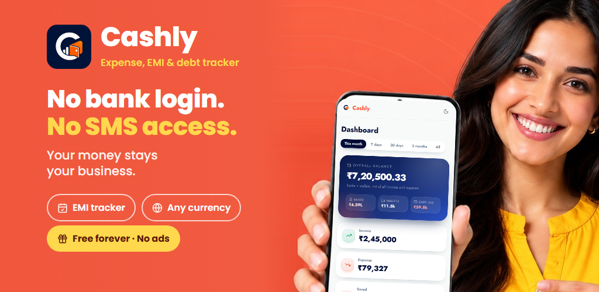

<p align="center">
  
</p>

<h1 align="center">Cashly API and MCP Server</h1>

<p align="center">
  Expense, EMI and debt tracker with a REST API and a remote MCP server.<br>
  Let ChatGPT, Claude, n8n or your own AI agent read and log your money, in any currency.
</p>

<p align="center">
  <a href="https://cashly.corenexis.com">Website</a> ·
  <a href="https://cashly.corenexis.com/developer/mcp">MCP guide</a> ·
  <a href="https://cashly.corenexis.com/developer/api">API docs</a> ·
  <a href="https://play.google.com/store/apps/details?id=com.corenexis.cashly">Google Play</a> ·
  <a href="https://registry.modelcontextprotocol.io/v0/servers?search=com.corenexis/cashly">MCP Registry</a>
</p>

<p align="center">
  
</p>

---

## What is Cashly?

[Cashly](https://cashly.corenexis.com) is a free personal finance app for Android and the web, used
worldwide in any currency and time zone. It tracks expenses and income, real balances for banks, cards
and wallets, EMIs and loans, money lent and borrowed, and bills before they are due. It never asks for a
bank login, never reads SMS and has no ads.

This repository is the public home of Cashly's **developer surface**:

| | |
|---|---|
| **MCP server** | `https://cashly.corenexis.com/api/mcp` - remote, Streamable HTTP, OAuth 2.1 or API key |
| **REST API** | `https://cashly.corenexis.com/api/v1` - JSON, `x-api-key` header |
| **Webhooks** | Signed event deliveries for every create, update and delete |
| **n8n** | Community node [`@corenexis/n8n-nodes-cashly`](https://www.npmjs.com/package/@corenexis/n8n-nodes-cashly) |
| **Registry name** | `com.corenexis/cashly` on the [Official MCP Registry](https://registry.modelcontextprotocol.io) |

The server is hosted by Corenexis. There is nothing to install or run: point your client at the URL.

## What you can do with it

Ask an assistant things like:

- "Add 450 for groceries paid by UPI today."
- "How much did I spend on food this month compared with last month?"
- "Which bills are due in the next 7 days?"
- "Record this month's car loan EMI as paid."
- "Who owes me money, and how much is left on each?"
- "Create a credit card called Travel Card with a 2,00,000 limit."

Every action works on the signed-in user's own data, and nothing moves real money: recording a payment
only updates the tracker.

## Quick start

### 1. Get access

- **ChatGPT and other OAuth clients:** no key needed. You sign in to Cashly and approve access.
- **Everything else:** create an API key in Cashly under **Settings -> Developer -> API keys**. Keys look
  like `cn_cashly_...` and can be read and write or read only. Up to 5 keys per account.

API, MCP and webhook access are part of the Cashly Pro and Pro Plus plans.

### 2. Connect your client

<details open>
<summary><b>ChatGPT</b> (OAuth, no key)</summary>

1. ChatGPT -> **Settings -> Apps (Connectors) -> Advanced**, turn on **Developer mode**.
2. **Create app** (add a custom MCP server):
   - Name: `Cashly`
   - Server URL: `https://cashly.corenexis.com/api/mcp`
   - Authentication: **OAuth** (leave client ID and secret empty - ChatGPT registers itself)
3. Press **Connect**, sign in to Cashly and press **Allow**. Tick **Read only** if ChatGPT should only look.

</details>

<details>
<summary><b>Claude Code</b></summary>

```bash
claude mcp add --transport http cashly https://cashly.corenexis.com/api/mcp \
  --header "x-api-key: cn_cashly_your_key_here"
```

</details>

<details>
<summary><b>Claude Desktop</b></summary>

Add this to `claude_desktop_config.json` (see [`examples/claude_desktop_config.json`](examples/claude_desktop_config.json)):

```json
{
  "mcpServers": {
    "cashly": {
      "command": "npx",
      "args": [
        "-y", "mcp-remote", "https://cashly.corenexis.com/api/mcp",
        "--header", "x-api-key:cn_cashly_your_key_here"
      ]
    }
  }
}
```

</details>

<details>
<summary><b>Cursor, VS Code and other MCP clients</b></summary>

Any client that supports remote Streamable HTTP servers can connect with:

```json
{
  "mcpServers": {
    "cashly": {
      "url": "https://cashly.corenexis.com/api/mcp",
      "headers": { "x-api-key": "cn_cashly_your_key_here" }
    }
  }
}
```

</details>

<details>
<summary><b>n8n</b></summary>

- **Workflows:** install the community node `@corenexis/n8n-nodes-cashly` (Settings -> Community nodes).
  It has every Cashly action plus an instant webhook trigger.
- **AI Agent:** add an **MCP Client** node (or the MCP Client Tool inside an AI Agent node), transport
  **HTTP Streamable**, endpoint `https://cashly.corenexis.com/api/mcp`, header `x-api-key` with your key.

</details>

<details>
<summary><b>curl / any HTTP client</b></summary>

```bash
# List the tools
curl -X POST https://cashly.corenexis.com/api/mcp \
  -H "x-api-key: cn_cashly_your_key_here" \
  -H "Content-Type: application/json" \
  -H "Accept: application/json, text/event-stream" \
  -d '{"jsonrpc":"2.0","id":1,"method":"tools/list"}'

# Log an expense
curl -X POST https://cashly.corenexis.com/api/mcp \
  -H "x-api-key: cn_cashly_your_key_here" \
  -H "Content-Type: application/json" \
  -H "Accept: application/json, text/event-stream" \
  -d '{
    "jsonrpc": "2.0",
    "id": 2,
    "method": "tools/call",
    "params": {
      "name": "create_transaction",
      "arguments": { "type": "debit", "amount": 500, "category": "Groceries" }
    }
  }'
```

</details>

## MCP tools

71 tools. Reads are marked read-only and deletes destructive, so clients can ask before acting.

| Area | Tools |
|---|---|
| Account | `get_profile`, `health_check`, `get_rate_limit_status`, `get_usage`, `get_user`, `update_user`, `get_billing_status`, `get_billing_payments`, `list_signed_in_devices`, `list_connected_apps`, `update_notifications` |
| Reference and stats | `get_categories`, `get_payment_methods`, `get_stats` |
| Transactions | `list_transactions`, `get_transaction`, `create_transaction`, `update_transaction`, `delete_transaction` |
| Debts (lend and borrow) | `list_debts`, `get_debt`, `create_debt`, `update_debt`, `delete_debt`, `record_debt_payment`, `settle_debt`, `add_to_debt`, `unsettle_debt` |
| Accounts | `list_accounts`, and list / create / update / delete for banks, credit cards, debit cards and wallets |
| EMIs and loans | `list_emis`, `get_emi`, `get_emi_payments`, `create_emi`, `update_emi`, `delete_emi`, `record_emi_payment` |
| Subscriptions | `list_subscriptions`, `get_subscription`, `get_subscription_payments`, `create_subscription`, `update_subscription`, `delete_subscription`, `record_subscription_payment` |
| Upcoming bills | `get_upcoming_bills`, `record_bill_payment`, `skip_upcoming_bill` |
| Webhooks | `list_webhook_events`, `list_webhooks`, `get_webhook`, `create_webhook`, `update_webhook`, `rotate_webhook_secret`, `delete_webhook`, `send_webhook_test`, `list_webhook_deliveries` |

Full list with arguments: [`docs/mcp.md`](docs/mcp.md).

## REST API

Base URL `https://cashly.corenexis.com/api/v1`, header `x-api-key: <key>` (or `Authorization: Bearer <key>`).

```bash
curl https://cashly.corenexis.com/api/v1/transactions \
  -H "x-api-key: cn_cashly_your_key_here" \
  -H "User-Agent: my-app/1.0"
```

Resources: `/me`, `/usage`, `/categories`, `/payment-methods`, `/stats`, `/transactions`, `/debts`,
`/accounts`, `/banks`, `/credit-cards`, `/debit-cards`, `/wallets`, `/emis`, `/subscriptions`,
`/upcoming-bills`, `/webhooks`. Data resources support list, get, create, update and delete.

Details, rate limits and error codes: [`docs/rest-api.md`](docs/rest-api.md). Webhooks: [`docs/webhooks.md`](docs/webhooks.md).

## Security and privacy

- OAuth 2.1 with PKCE and Dynamic Client Registration; access tokens last one hour.
- API keys can be read only; every request is scoped to the key owner's data.
- Keys and connected apps can be revoked any time in **Settings -> Developer**.
- No bank login, no SMS access, no card numbers. Data is never sold or shared with advertisers.

## Links

- Website: https://cashly.corenexis.com
- Try the app without an account: https://cashly.corenexis.com/api/auth/demo
- Android: https://play.google.com/store/apps/details?id=com.corenexis.cashly
- MCP guide: https://cashly.corenexis.com/developer/mcp
- API docs: https://cashly.corenexis.com/developer/api
- Support: https://helpdesk.corenexis.com or support@corenexis.com

---

Cashly is built by [Corenexis](https://corenexis.com). This repository holds documentation and examples;
the Cashly service itself is hosted by Corenexis. Examples are released under the [MIT License](LICENSE).
